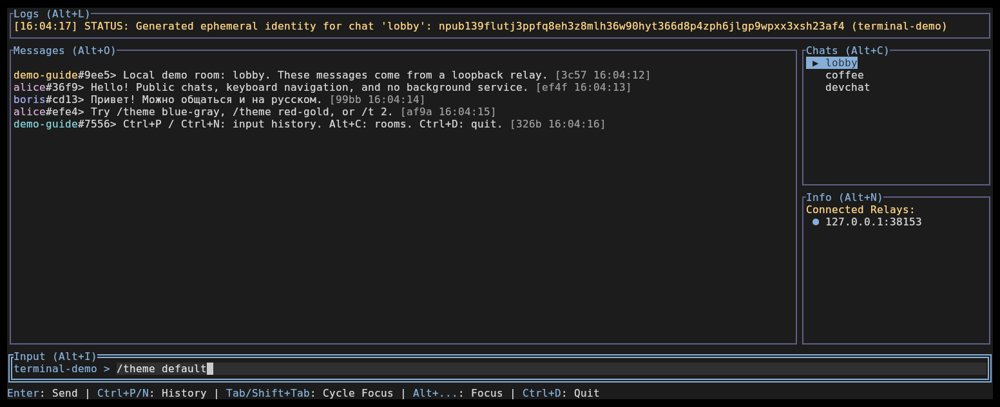

# strchat-tui

A keyboard-driven terminal client for **public Nostr chats**, with geographic
and named channels, local groups and SOCKS5/Tor support.



- Combine chats in a local group with one feed and a selected send destination.
- Reply with nickname completion; customize the feed with filters, mutes and themes.
- Connect through bundled relay catalogs, with automatic reconnection and NIP-42 authentication.
- Transform or suppress messages with optional [external plugins](examples/translate-plugin/PROTOCOL.md).

Compatible with **BitChat** public geohash chats and **Nymchat** named chats
when participants use the exact same channel and share a relay.

## Install

Prebuilt binaries for Linux, Windows, macOS (Intel and Apple silicon) and
Android/Termux are available in
[GitHub Releases](https://github.com/lessucettes/strchat-tui/releases/latest).

On Linux, download `strchat-tui-linux` and `SHA256SUMS`, then run:

```sh
sha256sum --ignore-missing -c SHA256SUMS &&
chmod +x strchat-tui-linux &&
./strchat-tui-linux
```

### Build from source

Requires **Go 1.27+**; no C compiler is needed. Use a full checkout, which includes
the local dependency in `third_party`:

```sh
git clone https://github.com/lessucettes/strchat-tui.git
cd strchat-tui
CGO_ENABLED=0 go build -tags purego -trimpath -o strchat-tui ./cmd/strchat-tui
./strchat-tui
```

### Build with Mage

Mage is pinned in `go.mod`; no separate installation is needed. From the repository root:

```sh
go run github.com/magefile/mage -l       # list targets
go run github.com/magefile/mage          # build all release binaries
go run github.com/magefile/mage linux    # or android, windows, macOS
```

All targets use `CGO_ENABLED=0` and `purego`. The default target builds all five
platform binaries; `linux` and `android` write `strchat-tui`, `windows` writes
`strchat-tui.exe`, and `macOS` builds both architectures.

## Start chatting

Enter commands in the Input pane:

```text
/nick alice
/join lobby coffee
/set lobby coffee
```

This joins two named chats and opens them as a local group. Choose a destination
in Info (`Alt+N`); Enter sends to that chat, never to the whole group.
Use `/join ucfv0` for a geographic channel. A leading `@nick#suffix` is a public
reply, not a direct message.

Type `/help` for the command reference. Pane titles and the footer show keyboard
shortcuts. Quit with `Ctrl+D` or `/quit`.

### Tor

With Tor listening locally:

```sh
./strchat-tui --socks=127.0.0.1:9050
```

Relay connections and DNS use the proxy, with no direct fallback. Pass the option
on each launch; it is not saved and does not configure external plugin traffic.

## Privacy and storage

- **Messages are public and unencrypted.** Tor does not guarantee anonymity;
  relays and peers may retain messages.
- Each chat uses an in-memory signing key. Restarting creates new identities;
  private keys and message history are not saved.
- The active chat announces presence with its session key every 40–80 seconds;
  in a group, only the selected chat announces, at any supported geo precision.
  Counts include you and keys seen in messages or heartbeats within five minutes,
  not a verified number of people. Silent reading of an announced chat is public.
- Settings, joined chats and local groups are stored in the OS user-config
  directory under `strchat-tui/config.json`.
- A relay acknowledgement confirms acceptance by that relay, not delivery to
  another participant. There is no persistent outbox.

## License

MIT; see [LICENSE](LICENSE). Bundled relay data is attributed in
`internal/client/georelays.go`; the local crypto dependency retains its own license.